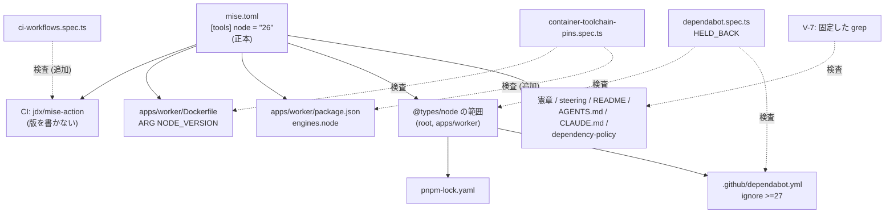
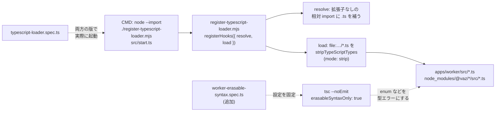
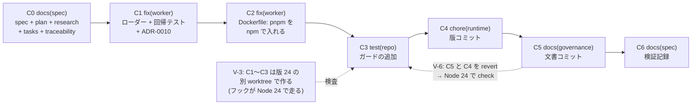
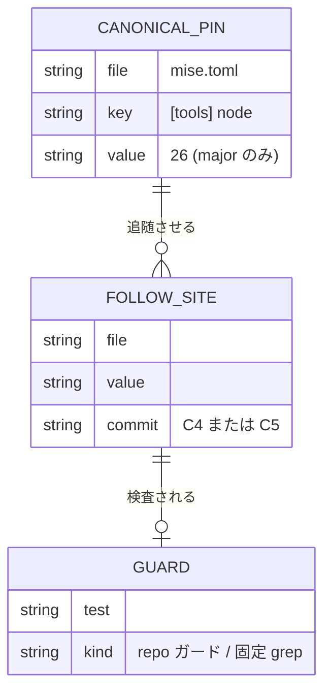

# 011-node-26-runtime-upgrade — Technical Plan

承認済みの要件（WHAT）を設計（HOW）へ移す。実装コードは書かない。調査の根拠は [`research.md`](research.md) の
investigation（I-1〜I-11）にある。散文は日本語、識別子・型・パス・コードは英語（`spec.json` `language: ja`）。

## Summary

Node の版は `mise.toml` を正本とし、他の箇所はそれに追随する。この構造は変えずに、正本を 24 から 26 へ動かす。
先に、Node 24 と 26 の両方で動く修正を入れる。worker ローダーを `registerHooks()` と `mode: "strip"` へ移し、
イメージ内の pnpm を npm で入れる。そのあとで版のピンを 1 コミットで動かし、憲章と文書を次のコミットで揃える。
こう分けると、版コミットと文書コミットを revert するだけで Node 24 に戻せる（R7）。

調査で、spec と gap-analysis にない問題が 1 つ見つかった。`node:26-slim` には corepack がなく、現在の Dockerfile は
ビルドできない（[`research.md`](research.md) I-6）。pnpm の用意を 1 行変える。この変更は spec の R2.6（Scope に追加済み。
`/sdd-analyze` の指摘 M-1「spec にない Dockerfile の変更」の反映）として扱い、版コミットより前の独立したコミット（C2）にする。
なお `/sdd-analyze` の指摘 ID（H-1、M-1 など）はラウンドごとに採番し直されるので、ID だけでは引けない。本書では ID に内容を添える。

## Architecture Overview

版の宣言は、正本 1 か所と追随箇所からなる。追随箇所のずれは repo ガードが検出する。破線は、本 plan で足すガードを示す。



worker のコンテナは、Node 自身の型除去で source-only の `@vaz/*` を読み込む。型除去で扱えない構文は、実行時ではなく
typecheck で止める。



コミットは役割ごとに分ける。C1〜C3 は Node 24 でも 26 でも成り立つ。C4 と C5 がロールバックの単位になる。



## Components

`DES-1.<n>` は `traceability.md` と `tasks.md` の `_Boundary:_` から参照する。

### DES-1.1: WorkerTypeScriptLoader

- **Responsibility**: `node_modules` 配下の source-only の `@vaz/*` と `apps/worker/src` を、Node 24 と Node 26 の両方で型除去だけで読み込む。
- **Public interface**: `register-typescript-loader.mjs`（`--import` で渡す登録ファイル。export はない）と、
  `typescript-loader.mjs` の同期フック `resolve` / `load`（シグネチャは「Interfaces / Contracts」）。
- **Owns**: 2 つの `.mjs` と、回帰テスト `apps/worker/tests/typescript-loader.spec.ts`（ケース L-1〜L-5）。
- **Does NOT own**: `apps/worker/src/*.ts` の内容。Dockerfile の `CMD`。`erasableSyntaxOnly` の設定（DES-1.2）。
  `stripTypeScriptTypes` の実験的 API からの脱却（Out of scope）。
- **Requirements**: 1.1, 1.2, 1.3, 1.5, 1.6

### DES-1.2: ErasableSyntaxGuard

- **Responsibility**: worker が読み込むソースの typecheck に `erasableSyntaxOnly` がかかっていることを、設定の実効値で固定する。
- **Public interface**: repo ガード `tests/repo/worker-erasable-syntax.spec.ts`。`tsc --showConfig -p <tsconfig>` の出力を検査する。
- **Owns**: 新しいガードのファイル 1 つ。
- **Does NOT own**: `packages/config/tsconfig.base.json` と各 `tsconfig.json`（変更しない）。`packages/evals` の typecheck
  （`--ignoreConfig` を使う。worker は読み込まない）。
- **Requirements**: 1.4

### DES-1.3: WorkerImageBuild

- **Responsibility**: `apps/worker` のイメージを、正本と同じメジャーの `node:<major>-slim` でビルドし、起動経路を通せる状態にする。
- **Public interface**: `apps/worker/Dockerfile`。`ARG NODE_VERSION`、`ARG PNPM_VERSION`、build 段の pnpm の用意、`CMD`。
- **Owns**: build 段の `RUN npm install --global pnpm@${PNPM_VERSION}`（corepack を使わない。Node 24 と Node 26 の両方で動く）、
  `ARG NODE_VERSION` の値、Dockerfile の中の版に関するコメント。**冒頭の「sandbox で build が塞がれている」という NOTE の
  書き換え**（N-8。V-5 でビルドを実測するので、事実と食い違う文を残さない。C5 で行う。DES-1.8 の対象でもある）。
- **Does NOT own**: `ARG PNPM_VERSION` の値（root `package.json` の `packageManager` に追随する。変更しない）。`CMD` の内容。
  Debian の版の固定（公式の `-slim` の既定に従う）。CI のビルドジョブ（Future Work）。ビルド内での `+sha512` 照合の再導入
  （D-2。ADR-0010 の再検討条件）。
- **Requirements**: 2.2, 2.6, 6.4, 6.5

### DES-1.4: RuntimePins

- **Responsibility**: 正本と、実行環境の追随箇所を Node 26 にする。
- **Public interface**: `mise.toml` の `[tools] node = "26"`、`apps/worker/Dockerfile` の `ARG NODE_VERSION=26`、
  `apps/worker/package.json` の `engines.node = ">=26"`。
- **Owns**: この 3 つの値。
- **Does NOT own**: 完全な版の固定（正本は major のみ。実際に動かした版は DES-1.10 が記録する）。`.github/workflows/*.yml`
  （変更しない）。root `package.json` の `engines`（持たない）。pnpm、TypeScript、Python の版。
- **Requirements**: 2.1, 2.2, 2.3

### DES-1.5: PinFollowGuards

- **Responsibility**: 追随箇所が正本からずれたとき、`mise run check` を落とす。
- **Public interface**: `tests/repo/container-toolchain-pins.spec.ts`（既存の `NODE_VERSION` の検査に、`engines.node` の検査を足す）、
  `tests/repo/ci-workflows.spec.ts`（ワークフローが Node の版を書いていないことの検査を足す）。
- **Owns**: 追加する 2 つの検査と、`container-toolchain-pins.spec.ts:15` の corepack に触れたコメントの訂正。
  CI の検査は「ワークフローが Node の版を `mise.toml` 以外に書かない」ことを、次の 4 つの否定条件と 1 つの前提で見る
  （`codeql.yml` と `dependency-review.yml` は mise を使わず Node も用意しないので、「全ワークフローが mise-action を使う」という
  肯定条件は置かない）。(1) `actions/setup-node` を使わない。(2) `node-version` キーを持たない。(3) `NODE_VERSION` 環境変数を定義しない。
  (4) **mise の版解決を上書きする入力を持たない**: `jdx/mise-action` ステップの `with:` に `install_args` / `mise_toml` が
  なく、ワークフロー・ジョブ・ステップのどの `env:` にも `MISE_` で始まるキーがない（`MISE_NODE_VERSION` などで、`mise.toml` と
  違う Node を CI だけに入れられるため。N-5）。前提: `jdx/mise-action` を使うステップが 1 件以上ある（0 件なら (4) は何も見ていない。
  anti-false-green。着手時点は 7 ファイル・13 か所。`research.md` I-9）。
  R2.4 の「正本から版を読む」は、`jdx/mise-action` が `mise.toml` を読む仕様に依拠する。ガードが保証するのは「別の版指定がない」ことで、
  「mise-action が `mise.toml` を読む」ことそのものは保証しない。この限界を `ci-workflows.spec.ts` のコメントに書く。
- **Does NOT own**: `tests/repo/dependabot.spec.ts`（DES-1.6）。ワークフローの内容。既存の検査の意味。
- **Requirements**: 2.4, 2.5

### DES-1.6: TypesAndDependabotHold

- **Responsibility**: `@types/node` と Dependabot の hold を、実行環境のメジャーに揃える。
- **Public interface**: root と `apps/worker` の `package.json` の `"@types/node": "^26.6.6"`、`pnpm-lock.yaml`、
  `.github/dependabot.yml` の `versions: [">=27"]` と理由コメント、`tests/repo/dependabot.spec.ts` の `HELD_BACK`（`heldMajor: 26`）。
- **Owns**: 上の 4 か所の値。
- **Does NOT own**: `typescript` の Fallback hold。他の依存の版（lockfile の差分は `@types/node` と、その依存の `undici-types`（7.24.6 → 8.9.0。作業ツリーの差分で実測）だけに限る。ダウングレード行は 0 件であること。憲章「サプライチェーン」、R6.8）。
- **Requirements**: 3.1, 3.2, 3.3, 3.4

### DES-1.7: GovernanceAmendment

- **Responsibility**: 憲章、steering、依存ポリシーを、版の変更と同じ PR で改める。
- **Public interface**: `.sdd/memory/constitution.md` 2.4.0（MINOR）、`.sdd/steering/tech.md` の Constraints、
  `docs/dependency-policy.md` の §7・§8・§8.1・§8.2、レビュー記録 `reviews/node26-constitution-r1.md`。
- **Owns**: 改正の文面（「Interfaces / Contracts」の「憲章改正の内容」）、新規コンテキストのレビュー、人間承認の記録。
- **Does NOT own**: 原則 1〜11 の文面（変更しない）。Turborepo の記述（前例のレビューが PATCH に送った項目。本改正では扱わない）。
  `next-agentic-stack` 側の記録（PR #77 でマージ済み）。
- **Requirements**: 4.1, 4.2, 4.3, 4.4, 4.5

### DES-1.8: ReaderFacingDocs

- **Responsibility**: 利用者と agent が読む記述を Node 26 に揃え、過去の記録は書き換えない。
- **Public interface**: `README.md`（英語 3 行、日本語 2 行）、`AGENTS.md:71`、`CLAUDE.md:60`、
  `docs/cross-repo-adoption-backlog.md:112`、`docker-compose.yml:86`、`apps/worker/tsconfig.json:2`、`apps/worker/src/main.ts:18`、
  `apps/worker/Dockerfile` の Node の版に触れるコメント 2 行と、冒頭の「sandbox で build が塞がれている」NOTE（N-8）。
  NOTE は「`docker build` は V-5 で実測済み（`do.md`）」の趣旨に書き換える。Inngest Connect に接続した実走が未実施である点は残す。
- **Owns**: 上の行の版の記述。記述の規則（Node 24 を述べる行は、同じ行に「Node 26」を書く）。
- **Does NOT own**: `specs/` 配下の過去の spec（5.6）。`docs/cross-repo-adoption-backlog.md:59`（X-15 の起票時の行。残す）。
  `apps/web/AGENTS.md`（関係のない差分。触らない）。
- **Requirements**: 5.1, 5.2, 5.3, 5.4, 5.5, 5.6

### DES-1.9: LoaderDecisionRecord

- **Responsibility**: worker ローダーとイメージの pnpm の設計判断を、再検討条件とともに ADR に残す。
- **Public interface**: `docs/adr/0010-worker-typescript-loader.md`。`AGENTS.md` と `CLAUDE.md` に、ADR へのリンクを持つ項を 1 つずつ足す。
- **Owns**: ADR の本文（Status、Date、仕様根拠、関連レビュー、Context、Decision、Alternatives、Consequences、再検討条件）。
  Consequences には、`research.md` D-2 の結論として「ビルド時の `packageManager` `+sha512` 照合は失われ、npm の `dist.integrity`
  （レジストリ自身の値）だけになった。2026-11-15 の実測で両者は一致した」ことを書く（N-3）。再検討条件には、ビルド内で
  sha512 を照合する手段（`npm pack` の結果の照合など）を足す条件を書く。
- **Does NOT own**: 既存の ADR。`docs/README.md`（`adr/` はディレクトリとしてリンク済み）。
- **Requirements**: 8.2

### DES-1.10: VerificationRecord

- **Responsibility**: 各ゲートを実行し、コマンド、Node の版、件数を記録する。
- **Public interface**: `specs/011-node-26-runtime-upgrade/pdca/do.md`、「Interfaces / Contracts」の検証手順 V-1〜V-9、PR の本文。
  **`do.md` は主の作業ツリー（`/Users/Shared/codes/vaz-agentic-ai-next`）にだけ置く。** 別 worktree の中での検証も、
  主の作業ツリーの `do.md` へ絶対パスで書く。worktree に置くと、P6 の `git worktree remove` で証拠が失われる（指摘 H-2「証拠の置き場」）。
- **Owns**: 検証の実行と記録。PR 本文の必須項目（ベータレーン記録へのリンク、R1 と R6 の結果、`mise run audit` の出力そのもの）。lockfile のダウングレード確認（R6.8）。
- **Does NOT own**: CI のジョブ定義。ローカルの firefox E2E（Out of scope）。Inngest に接続した実走（Future Work）。
- **Requirements**: 1.5, 4.6, 6.1, 6.2, 6.3, 6.4, 6.5, 6.6, 6.7, 6.8, NFR-1, NFR-2, NFR-3, NFR-4

### DES-1.11: CommitChoreography

- **Responsibility**: 変更を、revert で Node 24 に戻せる順序と単位でコミットする。
- **Public interface**: 「Interfaces / Contracts」のコミット計画 C1〜C6 と、ロールバックの手順。
- **Owns**: コミットの境界、ステージするパスの一覧、ブランチ（`chore/011-node-26-runtime-upgrade`）、1 PR にまとめること。
- **Does NOT own**: コミットの中身（各 DES が持つ）。`apps/web/AGENTS.md` の未コミットの差分（ステージしない。元にも戻さない）。
- **Requirements**: 7.1, 7.2, 7.3, 7.4, 7.5, 7.6, 8.4

### DES-1.12: SddArtifacts

- **Responsibility**: plan、tasks、traceability、レビュー記録を、コードと同期した状態で残す。
- **Public interface**: `specs/011-node-26-runtime-upgrade/` の `spec.md`、`plan.md`、`research.md`、`tasks.md`、`traceability.md`、
  `reviews/adversarial-r1.md`、`spec.json`。C0 で `spec.md`、`spec.json`、`plan.md`、`research.md`、`tasks.md`、`traceability.md` を
  まとめてコミットし、C1〜C5 がコミット済みの要件を引けるようにする（指摘 H-1「spec.md を C0 に入れる」）。
- **Owns**: 各 Requirement と、設計・タスク・テスト・コミットの対応。gap-analysis §6 の結果の記録（`research.md`）。
- **Does NOT own**: `spec.md` の要件の文面（変更には承認が要る）。`gap-analysis.md`（時点の記録として残す）。
- **Requirements**: 8.1, 8.3

## External Dependencies

第三者依存は足さない（原則 11）。版と入手方法が変わるものは次のとおり。

| Dependency | 変更 | 種別（原則 11） | 撤去・再検討の条件 |
|---|---|---|---|
| Node.js | 24 LTS → 26 LTS | 「新しすぎる版を選ばせない」ピン（major 固定） | Node 28 が LTS になったとき。ベータレーンの記録を経て、1 PR で動かす（`docs/dependency-policy.md` §8.2） |
| `@types/node` | `^24.19.2` → `^26.6.6`、hold は `>=27` | 同上（実行環境に追随する据え置き） | 実行環境の Node を上げるとき。型だけを先に上げない |
| `node:<major>-slim` | `24-slim` → `26-slim`（Debian 12 → 13） | 正本に追随する | 正本と同時に動かす。Dependabot は `ARG` 補間のタグを追えないので、ガードが検査する |
| pnpm（イメージ内） | 版は 12.8.2 のまま。入手を corepack → npm | 入手経路の変更。版の変更ではない | Node が corepack に代わる公式の手段を同梱したとき |
| `module.registerHooks` / `stripTypeScriptTypes` | Node の組み込み API（どちらも release candidate） | — | ADR-0010 の再検討条件（安定化、API の変更、worker へのビルド導入） |

## Data Model

永続データとスキーマの変更はない。本 spec が扱う「データ」は版の宣言である。正本 1 か所と、追随箇所ごとの検査手段を次に示す。



| 種別 | 箇所 | 値（変更後） | 検査手段 | コミット |
|---|---|---|---|---|
| 正本 | `mise.toml` `[tools] node` | `"26"` | — | C4 |
| 追随 | `apps/worker/Dockerfile` `ARG NODE_VERSION` | `26` | `container-toolchain-pins.spec.ts`（既存） | C4 |
| 追随 | `apps/worker/package.json` `engines.node` | `">=26"` | `container-toolchain-pins.spec.ts`（追加） | C4 |
| 追随 | root と `apps/worker` の `@types/node` | `"^26.6.6"` | `dependabot.spec.ts` `HELD_BACK`（既存） | C4 |
| 追随 | `pnpm-lock.yaml` の `@types/node` | `26.6.6` のみ | `pnpm install --frozen-lockfile`、V-7 の lockfile の確認 | C4 |
| 追随 | `.github/dependabot.yml` `ignore` | `versions: [">=27"]` | `dependabot.spec.ts`（既存） | C4 |
| 追随 | `.github/workflows/*.yml` | 版を書かない（`jdx/mise-action`） | `ci-workflows.spec.ts`（追加） | 変更なし |
| 追随 | 憲章、steering、`docs/dependency-policy.md` | Node 26 LTS | V-7 の grep、憲章のレビュー記録 | C5 |
| 追随 | `README.md`、`AGENTS.md`、`CLAUDE.md`、backlog、コメント 3 か所 | Node 26 | V-7 の grep | C5 |

## Interfaces / Contracts

### ローダーのフック（DES-1.1）

`node:module` の同期フックの型に従う。どちらも `Promise` を返さない。

```ts
// typescript-loader.mjs — synchronous hooks for module.registerHooks()
type Resolve = (
  specifier: string,
  context: ResolveHookContext,
  nextResolve: (specifier: string, context?: ResolveHookContext) => ResolveFnOutput,
) => ResolveFnOutput;

type Load = (
  url: string,
  context: LoadHookContext,
  nextLoad: (url: string, context?: LoadHookContext) => LoadFnOutput,
) => LoadFnOutput;
```

| フック | 入力 | 振る舞い |
|---|---|---|
| `resolve` | 任意の specifier | まず `nextResolve` に渡す。`ERR_MODULE_NOT_FOUND` で、かつ specifier が拡張子のない相対パスのときだけ、`.ts` を補って解決し直す。それ以外のエラーは投げ直す |
| `load` | `file:` で始まり `.ts` で終わる URL | `readFileSync` で読み、`stripTypeScriptTypes(source, { mode: "strip", sourceUrl: url })` の結果を `{ format: "module", shortCircuit: true, source }` で返す |
| `load` | それ以外 | `nextLoad` に渡す |

- `mode` は `"strip"` だけを使う。`sourceMap` は渡さない（Node 26 で削除された）。
- 型除去で扱えない構文は `ERR_UNSUPPORTED_TYPESCRIPT_SYNTAX` で失敗する。握りつぶさず、変換にも切り替えない（1.3）。
- 登録は `registerHooks({ resolve, load })`。`module.register()` は使わない。

### ローダーの回帰テスト（DES-1.1）

`apps/worker/tests/typescript-loader.spec.ts`。どのケースも `process.execPath` で子プロセスを起動する。そのため、テストを
動かした Node の版がそのまま検査対象になる（CI は 26、V-2 で 24 と 26 の両方）。フィクスチャは `mkdtempSync` で作った
一時ディレクトリに書き、`afterAll` で消す（L-3〜L-5 は上の「フィクスチャの置き場」に従う）。リポジトリに型除去で扱えない `.ts` を置かない。

| ケース | 起動 | 期待 | AC |
|---|---|---|---|
| L-1 | `--throw-deprecation --import <register> --input-type=module --eval <E>`、`cwd` は `apps/worker`。`<E>` は `src/` を `readdirSync` で列挙して全 `.ts` を import し、続けて `@vaz/config/logger` を import する | 列挙が 0 件でない（anti-false-green）。exit 0。stdout が `all-loaded <n>` で、`n` が `src/*.ts` の数と一致する。**このケースは `resolve` フック（拡張子なしの相対 import）の検査であり、`load` フックの検査ではない**（下の注を参照） | 1.1 |
| L-2 | L-1 と同じ起動 | stderr に `DeprecationWarning` がない。`--throw-deprecation` があるので、非推奨 API を使うと exit が 0 にならない | 1.2, 1.5 |
| L-3 | `--import <register> --input-type=module --eval "await import('@vaz/fixture/non-erasable')"`、`cwd` は `<tmp>`。対象は `<tmp>/node_modules/@vaz/fixture/src/non-erasable.ts`（`enum` を含む。実ファイル） | exit が 0 でない。stderr に `ERR_UNSUPPORTED_TYPESCRIPT_SYNTAX` がある（`ERR_UNSUPPORTED_NODE_MODULES_TYPE_STRIPPING` ではない。`load` フックに届いたことの証拠） | 1.3 |
| L-4 | `--import <register> --input-type=module --eval "await import('@vaz/fixture/throws')"`、`cwd` は `<tmp>`。対象は `<tmp>/node_modules/@vaz/fixture/src/throws.ts`（実ファイル）。型注釈のある行で `throw` し、throw の式より前の同じ行にも型注釈がある | スタックの先頭フレームの `行:列` が、フィクスチャの文字列から計算した位置と一致する | 1.6 |
| L-5 | `<tmp>/node_modules/@vaz/fixture/src/typed.ts`（型注釈のみ・実ファイル）を、(a) `--import <register>` 付き、(b) 登録なしの 2 通りで import する | (a) exit 0 で、値が返る。(b) exit が 0 でなく、stderr に `ERR_UNSUPPORTED_NODE_MODULES_TYPE_STRIPPING` がある。(b) が失敗することで、フィクスチャが「ローダーなしでは読めない」場所にあること（`load` フックが実際に働いていること）を示す | 1.1, 1.3 |

**フィクスチャの置き場（`load` フックを検査するための条件）**: workspace の `apps/worker/node_modules/@vaz/*` は `packages/*` への
symlink で、Node は realpath を使うため `node_modules` の外として読む。Node 26.13.1 で、ローダーなしに
`await import('@vaz/config/logger')` が成功することを実測した。したがって workspace を対象にした L-1 は、`load` フックを消しても通る。
`load` フックの存在理由（`pnpm deploy` 後の `node_modules` 配下の `.ts`）は、`mkdtempSync` で作った一時ディレクトリの
`node_modules/@vaz/fixture/` に **symlink ではなく実ファイル**を置いて初めて再現する（`package.json` は
`{"name":"@vaz/fixture","type":"module","exports":{"./*":"./src/*.ts"}}`）。L-3〜L-5 はこの置き場を使う。実測: ローダーなしでは
`ERR_UNSUPPORTED_NODE_MODULES_TYPE_STRIPPING`、ローダー付きでは値が読める（Node 26.13.1）。

L-4 の期待値はハードコードしない。フィクスチャの文字列の中で目印（`new Error("…")`）の位置を探し、1 始まりの行と列を計算する。

### ガードの検査（DES-1.2、DES-1.5）

| テスト | 検査 | anti-false-green |
|---|---|---|
| `worker-erasable-syntax.spec.ts` | `tsc --showConfig -p apps/worker/tsconfig.json` と `-p apps/web/tsconfig.json` の出力を JSON として読み、`compilerOptions.erasableSyntaxOnly === true` | 出力が JSON として読め、`compilerOptions` を持つことを先に検査する |
| `container-toolchain-pins.spec.ts`（追加） | `apps/worker/package.json` の `engines.node` が `>=<major>` の形で、`<major>` が `mise.toml` の `[tools] node` のメジャーと一致する | 両方の値がパースできることを先に検査する（既存の検査と同じ形） |
| `ci-workflows.spec.ts`（追加） | どのワークフローも `actions/setup-node` を使わず、`node-version` キー（`with:` の下）を持たず、`NODE_VERSION` 環境変数を定義しない。加えて、`jdx/mise-action` ステップの `with:` に `install_args` / `mise_toml` がなく、どの `env:`（ワークフロー・ジョブ・ステップ）にも `MISE_` で始まるキーがない。判定は否定条件だけで、「Node を使うワークフロー」の判別はしない | 既存の「1 件以上のワークフローを走査した」検査に加え、`jdx/mise-action` ステップを 1 件以上走査したことを先に検査する |

`tsc --showConfig` は実効値（`extends` を解決したあとの値）を返す。そのため、下位の tsconfig が `false` で上書きした場合も検出できる
（TypeScript 7.0.2 で `erasableSyntaxOnly: true` を返すことを実測した。約 0.2 秒）。ガードは root の `node_modules/.bin/tsc` を
子プロセスで起動する。

### 憲章改正の内容（DES-1.7）

| 箇所 | 変更 |
|---|---|
| Additional Constraints「ツールチェーン」 | 「Node 24 LTS と uv 0.13 系は `mise.toml`」→「Node 26 LTS と uv 0.13 系は `mise.toml`」 |
| Sync Impact Report（先頭のコメント） | 2.3.1 → 2.4.0 の内容に置き換える。Modified Sections（ツールチェーン、改訂履歴）、Templates Status（レビュー記録、`AGENTS.md` / `CLAUDE.md`、steering、依存ポリシー、`README.md`）、Deferred（`TODO(BRANCH_COVERAGE_THRESHOLD)` の継続）。基準を一行で書く:「宣言済みの版の変更は、意図した版上げ（判断の変更）を MINOR、実態への追随（強制された訂正）を PATCH とする」 |
| 改訂履歴 | 2.4.0 の行（MINOR）を足す。「Node 24 LTS → Node 26 LTS」と、同じ行に両方の版を書く |
| 末尾 | `**Version**: 2.4.0`、`**Last amended**` は文書コミットの日付 |

手順は Amendment procedure に従う。変更提案（本 plan）→ 新規コンテキストのレビュー（`sdd-reviewer`。作業ツリーの差分と
spec の R4 だけを渡す）→ 指摘への対応 → 人間承認の記録（承認者、日時、範囲）→ 版の昇格。承認の記録がない状態で C5 を
コミットしない。記録は `reviews/node26-constitution-r1.md` に置く。節の構成は前例（spec 009 の `python314-constitution-r1.md`）に合わせる。

### 依存ポリシーの変更（DES-1.7）

| 箇所 | 変更 |
|---|---|
| §7「保留中メジャーとの整合」 | `(@types/node 24、…)` → `(@types/node 26、…)` |
| §8 のレーン表、TypeScript ベータの行 | 検証対象から「Node 26」を外す。Python の行の前例にならい、「（Node 26 LTS はハブへ取り込み済み、2026-11-15）」と添える |
| §8.1 の `@types/node` の行 | `@types/node` `^26`、「ランタイムの Node 26 LTS に合わせている」。3 列目は変えない |
| §8.2 手順 2 | `HELD_BACK` 表と 8.1 の表について、「据え置きを解除するときは行を削除する。次のメジャーへ移すときは行を書き換える」と書き分ける |

ベータレーンの記録を文書の中で指すときは、コードスパンで書く
（`next-agentic-stack` の `docs/beta-lane/2026-11-15-node-26.md`）。リンクにしない（`doc-links.spec.ts`）。

### 検証手順（DES-1.10）

コマンドを固定する。記録先は `pdca/do.md`。どの手順も、最初に `node -v` の出力を記録する（6.7）。

| ID | 目的 | コマンド | 合格の条件 | AC |
|---|---|---|---|---|
| V-1 | Red の確認（3 段） | worktree（版 24）で、各段のあとに `mise exec node@<24 と 26> -- pnpm exec vitest run --project worker apps/worker/tests/typescript-loader.spec.ts` を実行する。**(0)** ローダーが `main` のまま（`transform` + `register()`）で L-1〜L-5 を書いた状態。**(a)** `typescript-loader.mjs` だけを `mode: "strip"`・同期版にし、`register-typescript-loader.mjs` は `register()` のままにした状態。**(b)** 登録を `registerHooks()` に移したあと、`load` を一時的に `nextLoad(url, context)` だけを返す形にした状態 | (0) Node 24: L-3（`enum` を受け入れる）と L-4（スタックの行がずれる。実測で `throws.ts:4:11`、正しくは 2 行目）が失敗し、L-1/L-2/L-5 は通る。Node 26: L-1〜L-5 が `ERR_INVALID_ARG_VALUE` で失敗する。(a) Node 24 は L-1〜L-5 が通る。Node 26 は L-2 が `DEP0205` で失敗する（1.5 の Red）。(b) L-3 / L-4 / L-5(a) が `ERR_UNSUPPORTED_NODE_MODULES_TYPE_STRIPPING` で失敗し、L-1 は通る（L-1 だけでは `load` を守れない証拠）。確認後に (b) を元へ戻す | 1.5, 1.1, 1.3, 1.6 |
| V-1c | C2 の Red | worktree（版 24、C2 の前）で `docker build --build-arg NODE_VERSION=26 -f apps/worker/Dockerfile -t vaz-worker:011-red .`（変更前の Dockerfile のまま） | build 段の `corepack` の行が `not found` で失敗する（Red）。C2 の変更後は、`--build-arg NODE_VERSION=24` と `=26` の両方でビルドが成功する（Green）。両方の出力を `do.md` に残す | 2.6 |
| V-1d | C4 の Red | 主の作業ツリー（P5 の ff-merge 直後、C3 の HEAD、`c4.patch` の他の部分を当てる前）で、`git apply --include=tests/repo/dependabot.spec.ts <scratchpad>/c4.patch` を当て、`pnpm exec vitest run --project repo tests/repo/dependabot.spec.ts` | `package.json` が `^24`、`dependabot.yml` が `>=25` の状態で、`HELD_BACK` の検査が落ちる（Red）。C4 の残りの差分を当てると通る（Green）。出力を `do.md` に残す | 3.2, 3.3 |
| V-2 | 両方の版での回帰 | 上のコマンドを `node@24` と `node@26` で実行する | 両方で L-1〜L-5 が通る | 1.1, 1.2, 1.3, 1.6 |
| V-3 | 版が 24 のままの状態 | P3 の worktree（`../vaz-agentic-ai-next-011-prep`、C3 まで）で `node -v`（24 であること）を記録し、`mise run check`。続けて `docker build -f apps/worker/Dockerfile -t vaz-worker:011-node24 .` | Node 24 で `check` の全段が成功する。イメージのビルドが成功する。C1〜C3 の各コミット時にフックが Node 24 で通ったことも記録する。終わったら P6 で worktree を消す | 7.3 |
| V-4 | Node 26 のゲート | 最終の HEAD で `mise run check`、`mise run build`、`mise run size`、`mise run openapi:gen && git diff --exit-code` | `check` が緑で、件数が 80 ファイル / 949 passed, 1 skipped から減らない。`size` が JS 420 kB / CSS 4.0 kB 以内。`openapi:gen` の差分が 0 | 6.1, 6.2, 6.3 |
| V-5 | イメージ | 下の「イメージの検証コマンド」 | ビルドが成功する。`all-loaded <n>`、exit 0、`DeprecationWarning` が 0 件。イメージ内の `pnpm --version` が `PNPM_VERSION` と一致する。`npm view pnpm@<PNPM_VERSION> dist.integrity` を hex に直した値が、root `package.json` の `packageManager` の `+sha512.` と一致する（N-3。ビルド内で照合できなくなった分の確認。2026-11-15 に 12.8.2 で一致を実測済み。`research.md` D-2） | 6.4, 6.5 |
| V-6 | ロールバックの予行 | `git worktree add -b verify/011-rollback ../vaz-agentic-ai-next-011-rollback HEAD` → その中で `git revert --no-edit <C5> <C4>` → `mise trust && mise install && pnpm install --frozen-lockfile && mise run check` | Node 24 で `check` の全段が成功する。終わったら作業ツリーとブランチを消す。push しない | 7.4 |
| V-7 | 残った記述 | 下の「記述の検査」 | 出力が 1 行（backlog の X-15 の行）だけ | 5.5 |
| V-8 | セキュリティ | `mise run audit`（`check` に含まれるが、PR 本文に貼るため単独で実行し、出力をそのまま `pdca/do.md` に保存する）、`mise run secret-scan`、`git diff main -- pnpm-lock.yaml`（C4 のコミット前にも、削除行と追加行を対にして確かめる） | 新しい指摘がない。検出が 0 件。lockfile のダウングレード行が 0 件（`undici-types` 7.24.6 → 8.9.0 は上げ方向で、`@types/node` 26 の依存として想定内） | NFR-3, 6.8 |
| V-9 | CI | PR を開き、全ジョブの結果を PR コメントに記録する（PR のチェック一覧が正本。リポジトリへは書き戻さず、C6 のあとにコミットを足さない） | 全ジョブが成功する。E2E と `eval-pr.yml` を含む | 6.6 |

**イメージの検証コマンド（V-5）**

```sh
docker build -f apps/worker/Dockerfile -t vaz-worker:011-node26 .
docker run --rm vaz-worker:011-node26 sh -c 'node -v; . /etc/os-release; echo "$PRETTY_NAME"'

EVAL='const { readdirSync } = await import("node:fs");
const files = readdirSync("./src").filter((f) => f.endsWith(".ts")).sort();
if (files.length === 0) throw new Error("no worker modules found");
for (const f of files) await import("./src/" + f);
process.stdout.write("all-loaded " + files.length);'

docker run --rm vaz-worker:011-node26 \
  node --throw-deprecation --import ./register-typescript-loader.mjs \
  --input-type=module --eval "$EVAL" >stdout.txt 2>stderr.txt; echo "exit=$?"
cat stdout.txt; grep -c DeprecationWarning stderr.txt

# pnpm の入手経路の確認（D-2）。ビルド内の sha512 照合がなくなった分を、host で補う
docker run --rm --entrypoint sh vaz-worker:011-node26 -c 'pnpm --version' 2>&1 || echo "(runtime 段に pnpm はない。build 段の確認は docker build の出力で代える)"
VER=$(grep -oE '"packageManager": *"pnpm@[0-9.]+' package.json | grep -oE '[0-9.]+$')
PM_HEX=$(grep -oE '\+sha512\.[0-9a-f]+' package.json | sed 's/+sha512\.//')
NPM_HEX=$(npm view "pnpm@$VER" dist.integrity | sed 's/^sha512-//' | base64 -d | xxd -p -c 256 | tr -d '\n')
[ "$PM_HEX" = "$NPM_HEX" ] && echo "integrity-match $VER" || echo "integrity-MISMATCH $VER"
```

runtime 段は `pnpm deploy` の出力だけを持つので、pnpm は入っていない。その場合、イメージ内の pnpm の版は `docker build --target build`
で別タグ（`vaz-worker:011-build`）を作って確かめる（`docker run --rm vaz-worker:011-build pnpm --version`）。記録には、どちらの方法で確かめたかを書く。

`CMD` の `src/start.ts` は DB と Inngest に接続しに行くので使わない。`start.ts` は `import.meta.main` で起動を守っているので、
import だけなら接続しない。記録には、`node -v`、OS の版、`exit`、stdout、`DeprecationWarning` の件数、stderr の全文を残す。

**記述の検査（V-7）**

```sh
git grep -nIE 'Node(\.js)? ?24|node:24|NODE_VERSION=24|types/node[^0-9]{0,8}24|>=2[45]' \
  -- . ':!specs/' ':!pnpm-lock.yaml' ':!services/*/uv.lock' \
  | grep -vE 'Node(\.js)? ?26'
```

- 1 段目は、Node 24 と `@types/node` 24 の記述を、`specs/` と lockfile を除いて拾う。着手時点の結果は 17 行（`research.md` I-10）。
- 2 段目は、同じ行に「Node 26」を書いた行を除く。移行（24 → 26）と両対応を述べる行がこれに当たる（DES-1.8 の記述の規則）。
- この規則は C1〜C3 の成果物（ADR-0010、回帰テスト、ローダー、Dockerfile の pnpm のコメント、ガード）にも課す。C5 の対象は 11 ファイルと、憲章改正のレビュー記録 1 件（`reviews/node26-constitution-r1.md`。合計 12 パス）に閉じており、これらを含まないので、C5 では直せない。C1・C2・C3 のコミット前に、追加行だけを検査する（`git diff --cached -U0` の `+` 行に、同じ行に「Node 26」のない Node 24 の記述が 0 行）。既存の行は C4・C5 で直すので、全体への V-7 は C5 のあとにだけ実行する。
- 合格の条件は、残りが `docs/cross-repo-adoption-backlog.md` の X-15 の行の 1 行だけであること。これは起票時の内容を記した表の行で、
  過去の記録として残す。同じファイルの「2026-10-07 時点」の行は現状を述べているので、「2026-11-15 時点: `@types/node` 26」へ更新する。
- `git grep` は追跡中のファイルだけを読む。C5 のコミットのあとに実行する。
- lockfile は別に確かめる: `grep -oE "@types/node@[0-9]+\.[0-9]+\.[0-9]+" pnpm-lock.yaml | sort | uniq -c` が 26 系だけを返す（3.1）。

### コミット計画（DES-1.11）

ブランチは `chore/011-node-26-runtime-upgrade`。ステージは `git add <path>` でパスを明示する。`git add -A` と `git add .` は使わない
（`apps/web/AGENTS.md` を混ぜないため）。件名は英語で書く。

**C1〜C3 は、版が 24 のままの別 worktree で作る。** 主の作業ツリーには、事前検証の差分（Node 26 のピン、lockfile、Dockerfile、
`@types/node`、ローダー）が未コミットで残っている。pre-commit フックは作業ツリー全体を検査するので、主の作業ツリーで C1〜C3 を
コミットするとフックは Node 26 の状態を見てしまい、R7.3（版が 24 のままで `check` が緑）を確かめたことにならない。
別 worktree なら `mise.toml` が 24 のままなので、フックがコミット時に Node 24 で走る。

| 手順 | 操作 | 備考 |
|---|---|---|
| P0 | 主の作業ツリーで C0（SDD の成果物）をコミットする | `spec.md`、`spec.json`、`plan.md`、`research.md`、`tasks.md`、`traceability.md` だけをステージする。`apps/web/AGENTS.md` と、版 24 から外れる事前検証の差分は含めない。`spec.json` は design と tasks の承認（人間の明示操作）のあとにステージする |
| P1 | 未コミットの差分を退避する。**まず、事前検証の差分を丸ごと一時ブランチへ退避コミットする**（N-4。patch は scratchpad にしか残らず、セッションの終了で失われうる。P5 は差分を捨てずに済む。patch 以外にも写しが残る）: `git switch -c wip/011-preverify` → 対象パス（下の C4 の分とローダーの分と `apps/worker/Dockerfile` と `apps/worker/tests/typescript-loader.spec.ts`。`apps/web/AGENTS.md` と `spec.json` は含めない）を `git add <path>` で明示 → `git commit -m "wip: node 26 pre-verification (local only, do not push)"` → `git switch chore/011-node-26-runtime-upgrade`。この `wip/011-preverify` は **push しない**。削除は PR のマージ後に利用者が決める。そのあと patch を作る。C4 の分: `git diff chore/011-node-26-runtime-upgrade wip/011-preverify -- mise.toml package.json pnpm-lock.yaml apps/worker/package.json .github/dependabot.yml tests/repo/dependabot.spec.ts > <scratchpad>/c4.patch`（**Dockerfile は含めない**。C4 では `ARG NODE_VERSION=26` の 1 行だけを手で直し、コメント 2 行は C5 で直す）。ローダーの分: 同様に `-- apps/worker/register-typescript-loader.mjs apps/worker/typescript-loader.mjs > <scratchpad>/c1-draft.patch`。`apps/worker/tests/typescript-loader.spec.ts` の差分は patch にしない（L-1〜L-5 で書き直す）。退避コミットのあと、`git status --short` が `apps/web/AGENTS.md` だけを示すことを確かめる | 退避後、新しい worktree で `git apply --check` が通ることを確かめる。`apps/web/AGENTS.md` と `spec.json` は退避もステージもしない。退避ブランチがあるので、事前検証の差分は失われず、`git diff wip/011-preverify` で元の内容をいつでも再確認できる |
| P2 | `git worktree add -b prep/011-loader ../vaz-agentic-ai-next-011-prep chore/011-node-26-runtime-upgrade`（C0 の HEAD から） | `mise.toml` は 24 のまま |
| P3 | その worktree で `mise trust && mise install && pnpm install --frozen-lockfile`、`node -v` が 24 であることを記録する。**この時点のローダーは `main` のまま**で、`c1-draft.patch` はまだ適用しない。L-1〜L-5 を先に書き（Red (0)）、`typescript-loader.mjs` の分だけ `git apply --include=apps/worker/typescript-loader.mjs c1-draft.patch` で入れ（Red (a)）、次に `register-typescript-loader.mjs` の分を入れて（Green）、C1〜C3 を順にコミットする | フックは Node 24 で走る。C2 の Dockerfile には C4 の行が存在しないので、`git add -p` は要らない。`do.md` は worktree に作らない（DES-1.10） |
| P4 | V-3 をこの worktree の C3 の状態で実行する（下の V-3） | Node 24 の check とイメージのビルドが通ることが、P5 に進む条件 |
| P5 | 主の作業ツリーで、`git status --short` が `apps/web/AGENTS.md` だけを示すことを確かめる（P1 で事前検証の差分を `wip/011-preverify` へ退避コミットしたので、対象パスは既に clean。**差分を捨てる操作はない**。`git restore` は使わない。N-4）。clean でなければ停止し、差分の出どころを特定する。続けて `git merge --ff-only prep/011-loader` → **V-1d の Red**（`dependabot.spec.ts` の差分だけを先に当てて落ちることを確かめる）→ 残りの `git apply --exclude=tests/repo/dependabot.spec.ts <scratchpad>/c4.patch` → `apps/worker/Dockerfile` の `ARG NODE_VERSION=24` を `26` に直す → C4 をコミットする。適用後、`git diff wip/011-preverify -- <C4 の対象パス>` が `ARG NODE_VERSION` と Dockerfile のコメント以外で空であることを確かめる（退避した事前検証の内容と一致する証拠） | 履歴は C0 → C1 → C2 → C3 → C4 の一本になる |
| P6 | `git worktree remove ../vaz-agentic-ai-next-011-prep && git branch -d prep/011-loader` | 証拠は主の作業ツリーの `do.md` にあるので、`--force` は要らない。`--force` が要るときは、worktree に未追跡の記録が残っている。消す前に主の作業ツリーへ写す |

| # | 件名（例） | 含めるファイル | Node 24 での状態 |
|---|---|---|---|
| C0 | `docs(spec 011): add spec revisions, plan, research and tasks` | `specs/011-node-26-runtime-upgrade/spec.md`、`spec.json`（design と tasks の承認後）、`plan.md`、`research.md`、`tasks.md`、`traceability.md` | 緑 |
| C1 | `fix(worker): load TypeScript through registerHooks in strip mode` | `apps/worker/register-typescript-loader.mjs`、`apps/worker/typescript-loader.mjs`、`apps/worker/tests/typescript-loader.spec.ts`、`docs/adr/0010-worker-typescript-loader.md`、`AGENTS.md` と `CLAUDE.md` のローダーの項（ADR へのリンク） | 緑 |
| C2 | `fix(worker): install pnpm with npm in the image build` | `apps/worker/Dockerfile` のうち、pnpm の用意の行とそのコメントだけ | 緑。Node 24 のイメージもビルドできる |
| C3 | `test(repo): guard erasable syntax and Node pin follow-sites` | `tests/repo/worker-erasable-syntax.spec.ts`、`tests/repo/container-toolchain-pins.spec.ts`、`tests/repo/ci-workflows.spec.ts` | 緑 |
| C4 | `chore(runtime): move the Node pin to 26 LTS` | `mise.toml`、`apps/worker/Dockerfile`（`ARG NODE_VERSION` の 1 行だけ）、`apps/worker/package.json`、`package.json`、`pnpm-lock.yaml`、`.github/dependabot.yml`、`tests/repo/dependabot.spec.ts` | —（版コミット） |
| C5 | `docs(governance): declare Node 26 LTS (constitution 2.4.0)` | `.sdd/memory/constitution.md`、`.sdd/steering/tech.md`、`docs/dependency-policy.md`、`README.md`、`AGENTS.md:71`、`CLAUDE.md:60`、`docs/cross-repo-adoption-backlog.md`、`docker-compose.yml`、`apps/worker/Dockerfile`（Node の版に触れるコメント 2 行と、冒頭の「sandbox で build が塞がれている」NOTE の書き換え。N-8）、`apps/worker/tsconfig.json`、`apps/worker/src/main.ts`、`reviews/node26-constitution-r1.md` | —（文書コミット。11 ファイル + レビュー記録 1 件の 12 パス） |
| C6 | `docs(spec 011): record verification and traceability` | `pdca/do.md`（新規）、`traceability.md`（Test と Commit の列）、`tasks.md`（完了印）、`reviews/adversarial-r1.md`（新規）、`spec.json`。`spec.md`・`plan.md`・`research.md` は、C0 以降に直したときだけ含める | — |

- C1〜C3 は版に依存しない。revert の対象にしない。
- C2・C4・C5 は同じファイル（Dockerfile）の別の行を変える。C2 は版が 24 の別 worktree で作るので C4 の行が存在せず、`git add -p` は要らない。
  C4 は `ARG` の 1 行、C5 はコメント 2 行を、それぞれの時点で手で直す（C4 の patch に Dockerfile を含めない）。
- C1〜C3 のコミット時のフックは、P3 の worktree で Node 24 を検査する。C4 のコミット時は、主の作業ツリーで Node 26 を検査する。
- **ロールバックの手順**: `git revert --no-edit <C5> <C4>` を 1 つの PR で出す。C4 だけの revert は、憲章・steering・README が
  Node 26 のまま残るので、正規の手順として扱わない（7.4）。revert 後もローダー、Dockerfile の pnpm の行、ガードは残り、Node 24 で動く。
- **マージの方法**: merge commit でマージする。squash と rebase は使わない。C4 と C5 の境界が消えると、上の手順で戻せなくなる。
- PR は 1 つ（7.5）。merge commit でのマージは R7.6 の要件で、本文にも書く。本文に必須の項目: `next-agentic-stack` PR #77 の記録
  （`docs/beta-lane/2026-11-15-node-26.md`、判定は部分解消）へのリンク、部分解消の残り（worker ローダーと Docker イメージ）を
  示す V-2 と V-5 の結果、実際に動かした Node の版、ロールバックの手順（4.6）、`mise run audit` の出力そのもの（V-8 で保存したもの。
  要約は不可。憲章「サプライチェーン」、6.8）。

## File Structure Plan

「着手時」の列は、作業ツリーに未コミットの差分が既にあるかを示す（[`research.md`](research.md)「着手時点の状態」）。

| File | Create/Modify | コミット | 着手時 | Responsibility |
|------|---------------|---|---|----------------|
| `apps/worker/register-typescript-loader.mjs` | Modify | C1 | 差分あり | `registerHooks()` で同期フックを登録する。コメントは「Node 24 と Node 26 の両方」と同じ行に書く |
| `apps/worker/typescript-loader.mjs` | Modify | C1 | 差分あり | 同期の `resolve` / `load`。`mode: "strip"` だけを使う |
| `apps/worker/tests/typescript-loader.spec.ts` | Modify | C1 | 差分あり（一部） | ケース L-1〜L-5 で、全モジュールの読み込み、非推奨 API の不使用、型除去のみ、行と列、`load` フックの働き（`node_modules` 配下の実ファイル）を検査する |
| `docs/adr/0010-worker-typescript-loader.md` | Create | C1 | — | ローダーとイメージの pnpm の設計判断、代替案、再検討条件を記録する |
| `AGENTS.md` | Modify | C1, C5 | — | C1: ローダーの制約の項を足し、ADR-0010 へリンクする。C5: 71 行目の据え置きを `^26`（Node 26 LTS）にする |
| `CLAUDE.md` | Modify | C1, C5 | — | C1: 「Things that bite」にローダーの項を足す。C5: 60 行目の据え置きを 26 にする |
| `apps/worker/Dockerfile` | Modify | C2, C4, C5 | 差分あり（C4・C5 の分） | C2: pnpm を `npm install --global` で入れる。C4: `ARG NODE_VERSION=26` の 1 行。C5: Node の版に触れるコメント 2 行（R5.3。`ARG` に隣接しないので、R7.2 により文書コミットへ） |
| `tests/repo/worker-erasable-syntax.spec.ts` | Create | C3 | — | worker と web の tsconfig の実効値で `erasableSyntaxOnly: true` を固定する |
| `tests/repo/container-toolchain-pins.spec.ts` | Modify | C3 | — | `engines.node` のメジャーを正本と突き合わせる検査を足す。corepack に触れたコメントを直す |
| `tests/repo/ci-workflows.spec.ts` | Modify | C3 | — | ワークフローが Node の版を書いていないことの検査を足す |
| `mise.toml` | Modify | C4 | 差分あり | 正本。`node = "26"` |
| `apps/worker/package.json` | Modify | C4 | 差分あり | `engines.node` を `>=26`、`@types/node` を `^26.6.6` にする |
| `package.json` | Modify | C4 | 差分あり | root の `@types/node` を `^26.6.6` にする |
| `pnpm-lock.yaml` | Modify | C4 | 差分あり | `@types/node` を 26.6.6 に、その依存の `undici-types` を 7.24.6 → 8.9.0 にする（ほかの行は変えない。ダウングレード行は 0 件） |
| `.github/dependabot.yml` | Modify | C4 | 差分あり | `@types/node` の hold を `>=27` にし、理由コメントを 26 LTS にする |
| `tests/repo/dependabot.spec.ts` | Modify | C4 | 差分あり | `HELD_BACK` の `heldMajor` を 26 にする |
| `.sdd/memory/constitution.md` | Modify | C5 | — | 2.4.0。ツールチェーンの記述、Sync Impact Report、改訂履歴、末尾の版と日付 |
| `.sdd/steering/tech.md` | Modify | C5 | — | Constraints の宣言済みの版を Node 26 LTS にする |
| `docs/dependency-policy.md` | Modify | C5 | — | §7、§8 のレーン表、§8.1 の行、§8.2 手順 2 を改める |
| `README.md` | Modify | C5 | — | 英語 3 行と日本語 2 行の前提を Node 26 LTS にする |
| `docs/cross-repo-adoption-backlog.md` | Modify | C5 | — | 112 行目の現状の記述を「2026-11-15 時点: `@types/node` 26」にする。59 行目は変えない |
| `docker-compose.yml` | Modify | C5 | — | 86 行目のコメントを Node 26 にする |
| `apps/worker/tsconfig.json` | Modify | C5 | — | 2 行目のコメントを Node 26 にする |
| `apps/worker/src/main.ts` | Modify | C5 | — | 18 行目のコメントを Node 26 にする（コードは変えない） |
| `specs/011-node-26-runtime-upgrade/reviews/node26-constitution-r1.md` | Create | C5 | — | 憲章改正の新規コンテキストのレビューと人間承認を記録する |
| `specs/011-node-26-runtime-upgrade/pdca/do.md` | Create | C6 | — | V-1〜V-9 のコマンド、Node の版、件数、Red の証拠を記録する |
| `specs/011-node-26-runtime-upgrade/traceability.md` | Create | C0, C6 | — | Requirement を設計・タスク・テスト・コミットへ対応づける。C0 で入れ、C6 で Test と Commit の列を埋める |
| `specs/011-node-26-runtime-upgrade/tasks.md` | Create | C0, C6 | — | 実装タスクと `_Boundary:_`。C0 で入れ、C6 で完了印を付ける |
| `specs/011-node-26-runtime-upgrade/reviews/adversarial-r1.md` | Create | C6 | — | 実装後の新規コンテキストの敵対的レビュー（原則 10） |
| `specs/011-node-26-runtime-upgrade/plan.md` | Create | C0 | — | 本書 |
| `specs/011-node-26-runtime-upgrade/research.md` | Create | C0 | — | 調査の記録（R8.3） |
| `specs/011-node-26-runtime-upgrade/spec.md` | Modify | C0 | 差分あり | R2.6、R7.1・R7.6 の改訂、NFR の ID、R6.8、Clarifications。C1〜C5 がコミット済みの要件を引くため、C0 に入れる（指摘 H-1「spec.md を C0 に入れる」）。R7.2 の文言整理（N-9）も含む |
| `specs/011-node-26-runtime-upgrade/spec.json` | Modify | C0, C6 | 差分あり | フェーズと承認の状態。C0 は design と tasks の承認後、C6 は `phase` を `implementation-complete` にする |

**触らないファイル**: `apps/web/AGENTS.md`（関係のない差分。ステージせず、元にも戻さない）、`.github/workflows/*.yml`、
`packages/config/tsconfig.base.json`、`specs/` 配下の他の spec、`specs/011-node-26-runtime-upgrade/gap-analysis.md`、
`docs/cross-repo-adoption-backlog.md:59`。

## Error Handling & Edge Cases

- ローダーが型除去で扱えない構文に当たる → `ERR_UNSUPPORTED_TYPESCRIPT_SYNTAX` で起動に失敗する。握りつぶさない。
  typecheck が先に検出する（1.3、1.4）。
- `resolve` が `ERR_MODULE_NOT_FOUND` 以外のエラーを受ける、または specifier が相対でない → そのまま投げ直す（1.1。現在の振る舞いを保つ）。
- 非推奨 API がローダーの外（依存パッケージ）にある → L-2 と V-5 は `--throw-deprecation` で落ちる。握りつぶさず、
  どのモジュールが出したかを `--trace-deprecation` で特定して記録する。対応は plan を改正してから決める（1.2、原則 9）。
- `docker build` が npm で入れた pnpm で失敗する → 停止して原因を特定する。`packageManager` との照合が原因なら、
  `research.md` D-2 の代替 (a)（`npm install --global corepack@<版>`）を検討し、plan を改正する（6.4）。
- コンテナの中で、全モジュールの import が環境変数を要求する → 接続しないダミーの値を `-e` で渡し、渡した変数名を記録する。
  `start.ts` の `main()` は呼ばない（6.5）。
- Docker デーモンが応答しない → Rancher Desktop を起動し、`docker --context rancher-desktop version` で確かめる。
  V-3 と V-5 を省略しない（Clarifications「イメージ起動まで必須」）。
- P3（C1〜C3 のコミット時のフック）、V-3、V-6 の別の作業ツリーで `mise run check` が落ちる → 停止する。版コミットに、両対応の修正に入れるべき変更が
  混ざっている疑いがある。コミットの境界を直す（7.3、7.4）。
- `pnpm install --frozen-lockfile` が別の作業ツリーで失敗する → lockfile と `package.json` が同じコミットに入っていない。
  C4 の内容を確かめる（7.2）。
- lockfile に `@types/node` と `undici-types` 以外の差分が出る、または同じパッケージの版が下がる行がある → 版コミットに入れない。原因（別の依存の再解決）を特定する（7.2、6.8）。
- テストの件数がベースラインより減る → 停止する。skip の追加や、テストの削除で緑にしない（6.1、原則 9）。
- CI の E2E または `eval-pr.yml` が Node 26 で落ちる → 再実行で済ませない。原因を特定し、Node 26 に起因するなら
  両対応の修正として C4 より前に入れ直す（6.6）。
- pre-push フックが Playwright E2E を走らせ、ローカルの firefox が起動しない → 既知の環境要因（Out of scope）。
  `sdd-preflight` の E2E の確認（Step 3.5）を先に行い、止まった場合は診断して記録する。`--no-verify` を使うかどうかは利用者が決める。
- PR を squash か rebase でマージする → C4 と C5 の境界が消え、revert でのロールバックができなくなる。merge commit でマージする（7.4）。
- 憲章の人間承認の記録がない → C5 をコミットしない（4.2）。
- 敵対的レビュー（9.2）や V-4〜V-6 の失敗で、C4 または C5 の対象ファイルを直す必要が出る（指摘 M-1「後続コミットが R7.4 のロールバック単位を崩す」）→
  直しを C6 以降の別コミットにしない。別コミットだと `git revert <C5> <C4>` だけでは Node 24 に戻らず、残った差分が Node 26 の記述を保持する。
  push 前なら、`git commit --fixup <C4 または C5>` で作り、`GIT_SEQUENCE_EDITOR=true git rebase --autosquash <C3>` で該当コミットへ畳む
  （利用者が許可した場合だけ。履歴の書き換えは外向きではないが、ローカルのコミットを変えるので確認する）。畳めない場合（push 済み、または
  利用者が書き換えを許さない場合）は、その修正コミットを V-6 の revert 対象（`git revert --no-edit <修正> <C5> <C4>`）と PR 本文のロールバック手順に加える。
  どちらを選んだかを `pdca/do.md` に書く。V-6 は、修正を反映した最終の HEAD で実行する（7.4）。
- V-7 の残りが 1 行でない → 現行の版としての「Node 24」の記述が残っているか、移行を述べる行が同じ行に「Node 26」を書いていない。
  文書を直す。grep のパターンや除外のパスを広げて合わせない（5.5）。

### Delivery sequence and gates

| 段 | 内容 | 次へ進む条件 |
|---|---|---|
| 0 | plan と tasks の承認（`approvals.design.approved` と `approvals.tasks.approved` を true にする。人間の明示操作による） | 利用者の承認（2 つとも） |
| 0.5 | P0〜P3: C0 をコミットし、版が 24 の worktree を作る | `node -v` が 24。退避した差分が `git apply --check` を通る |
| 1 | C1（worktree 内）: L-1〜L-5 を書く → V-1 (0)（`main` のローダーで Red）→ `typescript-loader.mjs` だけを strip・同期版にする → V-1 (a)（Node 26 の L-2 が `DEP0205` で Red）→ `registerHooks()` へ移す → V-2（Green）→ V-1 (b)（`load` を壊して Red、戻す） | 両方の版で L-1〜L-5 が通る。V-1 の (0)(a)(b) の出力を、主の作業ツリーの `do.md` に記録した |
| 2 | C2: **V-1c の Red**（変更前の Dockerfile で `--build-arg NODE_VERSION=26` が失敗する）→ Dockerfile の pnpm の行 → `docker build`（Node 24 と 26 の両方） | Red の出力が `do.md` にある。両方の版でビルドが成功する |
| 3 | C3: ガードを足す。それぞれ、設定を一時的に壊して落ちることを確かめてから戻す | 3 つのガードが、壊した状態で落ち、戻した状態で通る |
| 4 | V-3（P4）: worktree の C3 の状態を検査する | Node 24 で `check` が緑。Node 24 のイメージがビルドできる |
| 5 | P5〜P6: 作業ツリーが clean であることを確かめて ff-merge し、**V-1d の Red**（`heldMajor: 26` だけを先に当てて落ちる）→ C4 の残りの差分 → C4（版コミット）→ V-4 の `check` | Red の出力が `do.md` にある。Node 26 で `check` が緑 |
| 6 | 憲章のレビューと人間承認 → C5: 文書コミット → V-7 | 承認の記録がある。V-7 の残りが 1 行 |
| 7 | V-4（`build`、`size`、`openapi:gen`）、V-5、V-6、V-8 | すべて合格 |
| 8 | 新規コンテキストの敵対的レビュー → C6 → PR → V-9 | CRITICAL の指摘が残っていない。CI の全ジョブが成功する |

## Constitution Compliance

憲章 2.3.1（[`.sdd/memory/constitution.md`](../../.sdd/memory/constitution.md)）の MUST 原則に対して検査した。CRITICAL の違反はない。
⚠️ は 3 件で、どれも是正の手順を本 plan に入れてある。

| Principle | Status | Notes |
|-----------|--------|-------|
| 1. マルチエージェント化はトークン対価で正当化する | ✅ | エージェントの構成を変えない |
| 2. 層の責任境界を型で固定する | ✅ | 境界スキーマを変えない。`openapi:gen` の生成物がバイト単位で一致することを V-4 で確かめる |
| 3. 確率的振る舞いは 4 層で防御する | ✅ | 対象外（モデルとツールの振る舞いを変えない） |
| 4. 可観測性は後付けしない | ✅ | テレメトリの結線を変えない。strip モードで、スタックの位置が元のソースと一致するようになる（`research.md` I-4） |
| 5. 既存の単一経路に合流させる | ✅ | 新しいワークフローも CI の経路も足さない。ガードは既存の `repo` プロジェクトに置く |
| 6. コンテキストは有限のアテンション予算として扱う | ✅ | 対象外 |
| 7. 自律性は較正し、監査可能性で裏書きする | ✅ | 承認と監査の経路を変えない。worker の既存テストが Node 26 で緑のままであることを V-4 で確かめる |
| 8. 事実は実測で確定する | ⚠️ | 調査の結果は `research.md` に investigation として記録した（I-1〜I-11）。未実測は 2 件: `docker build` の成否と、コンテナ内での全モジュールの読み込み。どちらも V-5 で実測する。`research.md` に「未確認」と明記してある。文書だけを根拠にした主張はない |
| 9. テストを先に書く | ⚠️ | ローダーの修正、Dockerfile の pnpm、版のピンは、事前検証（`/dependency-security-refresh`）の差分として、強化したテストより先に作業ツリーにある。是正は 3 か所に分ける。**(C1 ローダー)** 差分は C1 の worktree に持ち込まず（P1・P3）、ローダーが `main` のまま L-1〜L-5 を先に書いて Red を取り（V-1 (0)）、実装を 2 段で入れる（(a) strip 版ローダー、次に `registerHooks()`）。(0) の Red は実測済み（Node 24 で L-3・L-4 が失敗、Node 26 で全件が `ERR_INVALID_ARG_VALUE`。`research.md` I-2）。**(C2 Dockerfile の pnpm)** 変更前の Dockerfile に `docker build --build-arg NODE_VERSION=26` を実行し、corepack が無くて失敗することを Red として `do.md` に残す（V-1 (c)。`/sdd-analyze` N-1）。変更後に Node 24 と Node 26 の両方でビルドが通ることを Green とする。**(C4 版のピン)** `dependabot.spec.ts` の `heldMajor: 26` だけを先に当て、`package.json` が `^24`、`dependabot.yml` が `>=25` の状態で落ちることを Red とする（V-1 (d)）。残りの差分を当てて Green にする。ガードは、設定を一時的に壊して落ちることを確かめる（段 3）。Red の出力を `pdca/do.md` に残す |
| 10. 段階ゲートを飛ばさない | ✅ | 要件の承認は、利用者が 2 回の Clarification のあとに `/sdd-plan … -y` を明示して実行したことによる。design（plan）と tasks の承認は、2026-11-15 に利用者が `/sdd-analyze` の報告（指摘 H-1「承認状態が plan と spec.json で食い違っている」）を読んだうえで、会話の中で明示した（「design と tasks を承認します」）。この確認の後で `spec.json` の `approvals.design.approved` と `approvals.tasks.approved` が true の状態を C0 に入れる。エージェントが承認を代行した記録はない。承認前に C0 をコミットしない。実装後に新規コンテキストの敵対的レビューを 1 回行い、`reviews/adversarial-r1.md` に残す。レビューは 1 ラウンド 1 ファイル |
| 11. 依存とバージョンは宣言に従う | ✅ | 第三者依存を足さない。版の変更は「External Dependencies」に宣言し、ピンの種別を書き分けた。モデル ID を書かない |
| Additional Constraints「ツールチェーン」 | ⚠️ | 正本 1 か所と追随の構造を保つ。憲章の「Node 24 LTS」は同じ PR で改める（DES-1.7）。ただし R7.2 に従ってコミットを分けるので、C4 と C5 の間は、正本が 26 で憲章が 24 になる。Governance の「同時に更新する」は PR の単位で満たす。そのため merge commit でマージし、C4 だけを revert する手順を認めない |
| Additional Constraints「CI / GH Actions」 | ✅ | ワークフローを変えない。SHA pin と `permissions:` の検査に影響しない |
| Additional Constraints「サプライチェーン」 | ✅ | 依存は足さない。ロック更新の差分は C4 のコミット前に目視し、ダウングレード行が 0 件であることを `pdca/do.md` に記録する（V-8、6.2）。`undici-types` 7.24.6 → 8.9.0 は `@types/node` 26 の依存で、上げ方向の想定内の変更（作業ツリーの差分で実測）。PR 本文には `mise run audit` の出力そのものを貼り、要約で済ませない（6.8）。`--frozen-lockfile` は変えない |
| Governance「Amendment procedure」「Versioning policy」 | ✅ | 変更提案 → 新規コンテキストのレビュー → 人間承認 → 2.4.0（MINOR）→ Sync Impact Report。上げ幅の基準を Sync Impact Report に一行で書く |

## Requirements Traceability

| Requirement ID | Component(s) | 検証 |
|----------------|--------------|---|
| 1.1 | DES-1.1 | L-1、L-5、V-2 |
| 1.2 | DES-1.1 | L-2、V-2、V-5 |
| 1.3 | DES-1.1 | L-3、L-5 |
| 1.4 | DES-1.2 | `worker-erasable-syntax.spec.ts`、`research.md` I-3 |
| 1.5 | DES-1.1, DES-1.10 | L-2、V-1（0）（a）（b） |
| 1.6 | DES-1.1 | L-4 |
| 2.1 | DES-1.4 | `mise.toml`、V-4 の `node -v` |
| 2.2 | DES-1.3, DES-1.4 | `container-toolchain-pins.spec.ts`、V-5 |
| 2.3 | DES-1.4, DES-1.5 | `container-toolchain-pins.spec.ts`（追加） |
| 2.4 | DES-1.5 | `ci-workflows.spec.ts`（追加。否定条件 4 つと、`jdx/mise-action` を 1 件以上走査した前提。「mise-action が `mise.toml` を読む」こと自体は保証しない） |
| 2.5 | DES-1.5 | `container-toolchain-pins.spec.ts`（既存） |
| 2.6 | DES-1.3 | V-3（版 24 のイメージ）、V-5（版 26 のイメージ） |
| 3.1 | DES-1.6 | V-7 の lockfile の確認、`pnpm install --frozen-lockfile` |
| 3.2 | DES-1.6 | `dependabot.spec.ts` |
| 3.3 | DES-1.6 | `dependabot.spec.ts`（`HELD_BACK`） |
| 3.4 | DES-1.6 | レビュー（コメントの文面） |
| 4.1 | DES-1.7 | V-7、`reviews/node26-constitution-r1.md` |
| 4.2 | DES-1.7 | `reviews/node26-constitution-r1.md` |
| 4.3 | DES-1.7 | `reviews/node26-constitution-r1.md`（Sync Impact Report の一行） |
| 4.4 | DES-1.7 | V-7 |
| 4.5 | DES-1.7 | V-7、`doc-links.spec.ts` |
| 4.6 | DES-1.10 | PR の本文 |
| 5.1 | DES-1.8 | V-7 |
| 5.2 | DES-1.8 | V-7 |
| 5.3 | DES-1.3, DES-1.8 | V-7 |
| 5.4 | DES-1.8 | V-7 |
| 5.5 | DES-1.8, DES-1.10 | V-7 |
| 5.6 | DES-1.8 | `git diff --stat main -- specs/` に、`specs/011-node-26-runtime-upgrade/` 以外が出ない |
| 6.1 | DES-1.10 | V-4 |
| 6.2 | DES-1.10 | V-4 |
| 6.3 | DES-1.10 | V-4 |
| 6.4 | DES-1.3, DES-1.10 | V-5 |
| 6.5 | DES-1.3, DES-1.10 | V-5 |
| 6.6 | DES-1.10 | V-9 |
| 6.7 | DES-1.10 | `pdca/do.md` |
| 6.8 | DES-1.6, DES-1.10 | V-8、`pdca/do.md`（ダウングレード確認）、PR の本文（`mise run audit` の出力） |
| 7.1 | DES-1.11 | コミット計画 C1 |
| 7.2 | DES-1.11 | コミット計画 C4、C5 |
| 7.3 | DES-1.11, DES-1.10 | V-3 |
| 7.4 | DES-1.11, DES-1.10 | V-6 |
| 7.5 | DES-1.11 | PR が 1 つ |
| 7.6 | DES-1.11 | PR 本文、マージ後の `git log --merges` |
| 8.1 | DES-1.12 | `plan.md`、`tasks.md`、`traceability.md` |
| 8.2 | DES-1.9 | `docs/adr/0010-worker-typescript-loader.md`、`doc-links.spec.ts` |
| 8.3 | DES-1.12 | `research.md` I-1〜I-8、I-11 |
| 8.4 | DES-1.11 | コミット計画（ステージするパスの明示、ブランチ名） |
| NFR-1 | DES-1.1, DES-1.10 | V-2（Node 24 と 26 の両方） |
| NFR-2 | DES-1.10 | V-4 の `size` |
| NFR-3 | DES-1.10 | V-8 |
| NFR-4 | DES-1.4, DES-1.5 | `ci-workflows.spec.ts`（追加）、`container-toolchain-pins.spec.ts`、V-4 の `node -v` |
